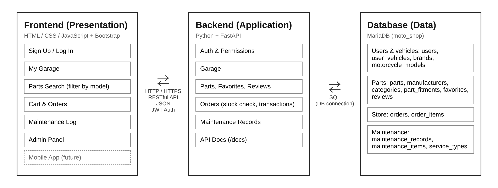
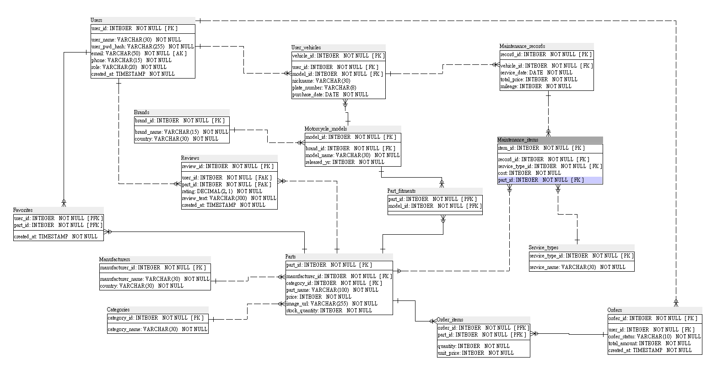
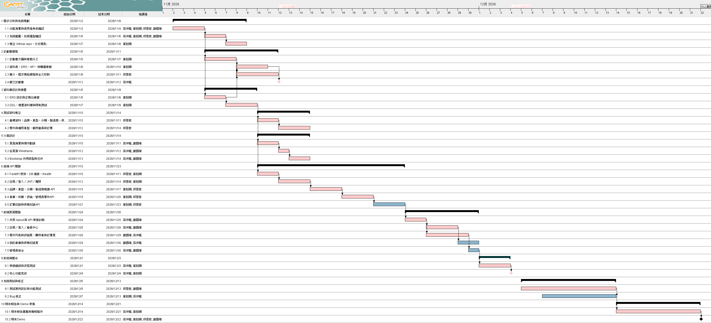

# Moto Shop — Motorcycle Parts Store & Maintenance Tracker

A three-tier web application that helps motorcycle owners find parts that fit their own bike, order them online, and keep a record of every service.

Course project · Department of Computer Science and Engineering, National Chung Hsing University (Fall 2026)

> **Status:** Design complete (database schema, API specification, system architecture). Implementation in progress; core features targeted for **Dec 4, 2026**, final demo on **Dec 22, 2026**.

---

## Overview

Motorcycle owners face two recurring problems: it is hard to tell which parts actually fit their model, and service history is scattered across paper receipts. This project combines a **parts store** and a **maintenance log** into one flow:

**Register your bike → see only compatible parts → place an order → log the service**

## Features

| Module | Description |
|---|---|
| Accounts | Sign up / log in with hashed passwords and JWT authentication; customer and admin roles |
| My Garage | Register one or more motorcycles (brand, model, plate number) |
| Parts Catalog | Search by category, manufacturer, or keyword; filter to parts compatible with a given model |
| Favorites & Reviews | Save parts; rate and review them (one review per user per part) |
| Store & Orders | Cart, checkout with stock validation, order history and status |
| Maintenance Log | Record service date, mileage, total cost, and the parts replaced |
| Admin Panel | Manage parts, prices, stock, and order status |

## Architecture



| Tier | Technology |
|---|---|
| Presentation | HTML / CSS / JavaScript, Bootstrap 5 |
| Application | Python, FastAPI, Uvicorn |
| Data | MariaDB (InnoDB, utf8mb4) |

The frontend never talks to the database directly — all data access goes through a RESTful JSON API, so a future mobile app can reuse the same backend.

## Database Design

15 tables in four groups. Full DDL: [`database/schema.sql`](database/schema.sql)



| Group | Tables |
|---|---|
| Users & vehicles | `users`, `user_vehicles`, `brands`, `motorcycle_models` |
| Parts | `parts`, `manufacturers`, `categories`, `part_fitments`, `favorites`, `reviews` |
| Store | `orders`, `order_items` |
| Maintenance | `maintenance_records`, `maintenance_items`, `service_types` |

Key design decisions:

- **M:N relationships resolved with junction tables** (`part_fitments`, `favorites`, `order_items`) using composite primary keys.
- **Price snapshot:** `order_items.unit_price` stores the price at checkout, so later price changes do not alter past orders.
- **Integrity enforced in the database:** foreign keys, `UNIQUE(email)`, and `UNIQUE(user_id, part_id)` on reviews.
- **Transactional checkout:** stock check, order insert, and stock deduction run in a single transaction and roll back together on failure.
- **Passwords stored only as bcrypt hashes.**

## API

29 REST endpoints across auth, catalog, garage, favorites, reviews, orders, maintenance, and admin. Examples:

| Method | Endpoint | Description |
|---|---|---|
| `GET` | `/api/health` | Service and database health check |
| `POST` | `/api/auth/login` | Log in and receive a JWT |
| `GET` | `/api/parts?model_id=3` | Parts compatible with a given model |
| `POST` | `/api/orders` | Create an order (transactional stock deduction) |
| `POST` | `/api/vehicles/{id}/maintenance` | Add a service record |

The full specification is in the [project plan](docs/project_plan_v3.pdf). Once the backend is running, interactive docs are available at `http://localhost:8000/docs`.

## Project Timeline



| Milestone | Date |
|---|---|
| Project plan submitted | Nov 12, 2026 |
| Core features complete | Dec 4, 2026 |
| Final demo | Dec 22, 2026 |

## Team

| Member | Role |
|---|---|
| 黃冠穎 Edwin Huang | Team lead · Database design · Backend core (API, auth, transactions) · Integration |
| 梁仲龍 | Frontend lead (UI design, pages) |
| 謝國瑋 | Frontend · Testing |
| 邱恩哲 | Backend support · Test data · Documentation |

## Getting Started

**Database**

```sql
CREATE DATABASE moto_shop DEFAULT CHARACTER SET utf8mb4;
USE moto_shop;
SOURCE database/schema.sql;
```

Backend and frontend setup instructions will be added as implementation progresses.

## Repository Structure

```
moto_shop/
├── docs/        Project plan, ERD, Gantt chart, architecture diagram
├── database/    Schema (DDL) and seed data
├── backend/     FastAPI application
└── frontend/    Web client
```
